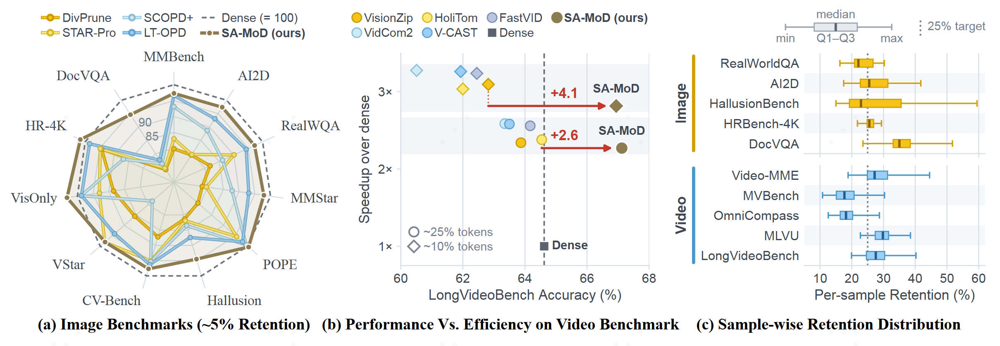
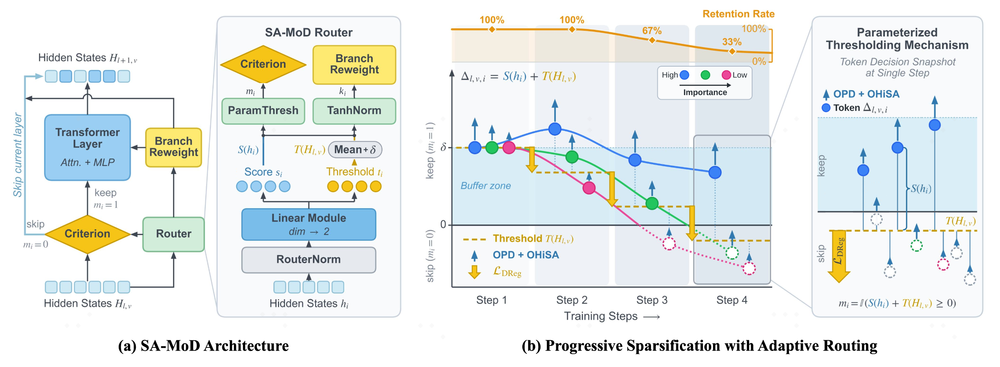
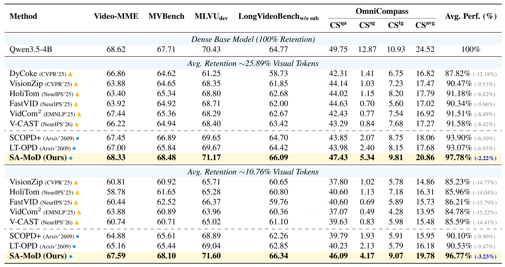

<div align="center">
<p align="center">
  
</p>
<h1 align="center">SA-MoD: Sparsity-Adaptive Mixture-of-Depth for<br>Efficient Vision-Language Models</h1>
<p align="center">
  Bairui Li<sup>1,2</sup>,
  Xinyu Wei<sup>1,2</sup>,
  Xuyang Liu<sup>1,2</sup>,
  Jinrui Zhang<sup>1,2</sup>,
  Zhiyuan Qi<sup>1</sup>,<br>
  Zeqing Wang<sup>1,2</sup>,
  Wentong Li<sup>1,&#x2709;&#xFE0E;,&Dagger;</sup>,
  Lei Zhang<sup>1,2,&#x2709;&#xFE0E;</sup>
</p>
<p align="center">
  <sup>1</sup>The Hong Kong Polytechnic University &nbsp;&nbsp;
  <sup>2</sup>OPPO Research Institute<br>
  <sub><sup>&#x2709;&#xFE0E;</sup> Corresponding authors (<a href="mailto:liwentong95@gmail.com">liwentong95@gmail.com</a>, <a href="mailto:cslzhang@comp.polyu.edu.hk">cslzhang@comp.polyu.edu.hk</a>). &nbsp;&nbsp; <sup>&Dagger;</sup> Work done during visiting in PolyU.</sub>
</p>
<p align="center">
  <a href="https://arxiv.org/abs/XXXX.XXXXX"></a>&nbsp;
  <a href="https://huggingface.co/VCLab-PolyU/SA-MoD"></a>&nbsp;
  <a href="https://huggingface.co/datasets/VCLab-PolyU/SA-MoD-41K"></a>
  
</p>
</div>

---

## 📌 Quick Links

[News](#news) · [Highlights](#highlights) · [Pipeline](#pipeline) · [Performance](#performance) · [Code Layout](#code-layout) · [Setup](#setup)

[Models and Checkpoints](#models-and-checkpoints) · [Datasets](#datasets) · [Training](#training) · [Evaluation](#evaluation) · [Citation](#citation) · [Acknowledgements](#acknowledgements)

If you find this repo useful, a star ⭐ would be greatly appreciated.

## 📰 News

- **[2026-11-26]** 📦 **Training data released!** `SA-MoD-Image-25K` and `SA-MoD-Video-16K` is now available on HuggingFace: [SA-MoD-41K](https://huggingface.co/datasets/VCLab-PolyU/SA-MoD-41K).
- **[2026-11-26]** 🤗 **Checkpoints released!** We released three checkpoints: `Qwen3.5-4B-SAMoD-Image-R05`, `Qwen3.5-4B-SAMoD-Image-R25`, and `Qwen3.5-4B-SAMoD-Video-R10`, now available on HuggingFace [SA-MoD](https://huggingface.co/VCLab-PolyU/SA-MoD).
- **[2026-11-26]** 🚀 **Code released!** Training and integrated image/video evaluation pipelines are now public.

## ✨ Highlights

**Sparsity-Adaptive Mixture-of-Depth (SA-MoD)** is a single-stage post-training framework for efficient long-context visual understanding in vision-language models (VLMs).

- **Sparsity-adaptive Token Routing via Progressive Dense-to-Sparse Transition.** Integrates the **Parameterized Thresholding Mechanism**, **RouterNorm**, and **Density-aware Regularization** to learn content-adaptive, layer-wise visual token routing in a single stage, without fixed budgets, predefined training schedules, and train-inference discrepancies.
- **On-Policy Distillation with Online Hidden-State Alignment (OHiSA).** Adopts On-Policy Distillation as the training objective and aligns teacher and student hidden representations conditioned on the student's sparse trajectory, providing reliable layer-wise supervision.
- **Strong Performance and Efficiency across image and video tasks.** On `Qwen3.5-4B`, SA-MoD retains **99.60% / 95.57%** of dense performance across 12 image benchmarks at **25% / 5%** vision-token retention, and **97.78% / 96.77%** across 5 video benchmarks at **25% / 10%** retention, while delivering up to **3.95×** end-to-end speedup.



## 🧭 Pipeline



## 📊 Performance

🖼️ Image Benchmark Results

Results in Tab. 2 of the paper


🎬 Video Benchmark Results

Results in Tab. 4 of the paper




## 📁 Code Layout

```text
SA-MoD/
├── VLMEvalKit/                     # Image evaluation suite
├── lmms-eval/                      # Video evaluation suite
├── samod/                          # Training core: Qwen3.5 SAMoD, OPD
└── scripts/
    ├── run_opd_qwen3_5_samod.sh    # On-policy self-distillation training launcher
    ├── merge_checkpoint.sh         # FSDP-to-HF checkpoint merger
    └── eval/
        ├── image_eval/             # VLMEvalKit launcher and benchmark config
        └── video_eval/             # lmms-eval video evaluation launchers
```

## 🛠️ Setup

Use Python 3.12 with a CUDA 13.0 environment. Install PyTorch, dependencies, local packages, and attention kernels:

```bash
pip install torch==2.10.0 torchvision==0.25.0
pip install -e samod
pip install -e lmms-eval --no-deps
pip install -e VLMEvalKit --no-deps
pip install flash-attn==2.8.2 --no-build-isolation
pip install flash-linear-attention==0.4.2 --no-build-isolation
```

## 📦 Models and Checkpoints

### Base Model

Download the base `Qwen3.5-4B` checkpoint into `pretrained/Qwen3.5-4B` (used as the initialization and frozen teacher for training, and as the dense baseline for evaluation):

```bash
hf download Qwen/Qwen3.5-4B --local-dir pretrained/Qwen3.5-4B
```

### SA-MoD Released Checkpoints

We release all trained SA-MoD checkpoints on [`VCLab-PolyU/SA-MoD`](https://huggingface.co/VCLab-PolyU/SA-MoD), organized as subfolders:

<table>
  <thead>
    <tr>
      <th width="335" align="left">Model</th>
      <th width="100" align="center">Modality</th>
      <th width="105" align="center">Retention</th>
      <th width="355" align="left">Subfolder</th>
    </tr>
  </thead>
  <tbody>
    <tr>
      <td><code>Qwen3.5-4B-SAMoD-Image-R05</code></td>
      <td align="center">Image</td>
      <td align="center">5%</td>
      <td><code>./Qwen3.5-4B-SAMoD-Image-R05/</code></td>
    </tr>
    <tr>
      <td><code>Qwen3.5-4B-SAMoD-Image-R25</code></td>
      <td align="center">Image</td>
      <td align="center">25%</td>
      <td><code>./Qwen3.5-4B-SAMoD-Image-R25/</code></td>
    </tr>
    <tr>
      <td><code>Qwen3.5-4B-SAMoD-Video-R10</code></td>
      <td align="center">Video</td>
      <td align="center">10%</td>
      <td><code>./Qwen3.5-4B-SAMoD-Video-R10/</code></td>
    </tr>
  </tbody>
</table>

Download all checkpoints into `pretrained/`, or use `--include` to download a specific subfolder:

```bash
# Download all released checkpoints
hf download VCLab-PolyU/SA-MoD --local-dir pretrained/

# Or download a single checkpoint
hf download VCLab-PolyU/SA-MoD --include "Qwen3.5-4B-SAMoD-Image-R05/*" --local-dir pretrained/
```

## 🗂️ Datasets

### Training Data

We release both the image and video training datasets on [`VCLab-PolyU/SA-MoD-41K`](https://huggingface.co/datasets/VCLab-PolyU/SA-MoD-41K):

<table>
  <thead>
    <tr>
      <th width="195" align="left">Dataset</th>
      <th width="100" align="center">Modality</th>
      <th width="100" align="center">Samples</th>
      <th width="500" align="left">Subset Path</th>
    </tr>
  </thead>
  <tbody>
    <tr>
      <td><code>SA-MoD-Image-25K</code></td>
      <td align="center">Image</td>
      <td align="center">25,000</td>
      <td><code>./SA-MoD-Image-25K/</code></td>
    </tr>
    <tr>
      <td><code>SA-MoD-Video-16K</code></td>
      <td align="center">Video</td>
      <td align="center">16,000</td>
      <td><code>./SA-MoD-Video-16K/train_video_16k.parquet</code></td>
    </tr>
  </tbody>
</table>

Download the training datasets from Hugging Face:

```bash
hf download --repo-type dataset VCLab-PolyU/SA-MoD-41K --local-dir datasets/SA-MoD-41K
```

> **Note for `SA-MoD-Video-16K`:** We only distribute the video annotations with paths relative to `Video-R1-data`. For video training, please download the raw videos from [`Video-R1/Video-R1-data`](https://huggingface.co/datasets/Video-R1/Video-R1-data) (e.g., into `datasets/Video-R1-data/`) and set `VIDEO_ROOT` in [`scripts/run_opd_qwen3_5_samod.sh`](scripts/run_opd_qwen3_5_samod.sh) to that directory:
>
> ```bash
> hf download --repo-type dataset Video-R1/Video-R1-data --local-dir datasets/Video-R1-data
> ```

### Evaluation Data

Image benchmarks are stored in `$LMUData`, and video benchmarks are cached in `$LMMS_EVAL_DATASETS_CACHE`. Both frameworks download missing benchmark files automatically on first run or reuse existing local caches.

## 🧪 Training

Launch single-node training on 8 GPUs:

```bash
NNODES=1 NGPU=8 bash scripts/run_opd_qwen3_5_samod.sh
```

Checkpoints, rollout logs, and a snapshot of the launch script and [`samod_cfg.json`](samod/verl/models/qwen3_5_samod/configs/samod_cfg.json) are saved to `workbench/<experiment_name>/<timestamp>/`. When training finishes, the script automatically merges the latest FSDP checkpoint into a Hugging Face checkpoint directory.

### Training Hyperparameters

General training, rollout, and data hyperparameters can be edited directly at the top of [`scripts/run_opd_qwen3_5_samod.sh`](scripts/run_opd_qwen3_5_samod.sh):

<table>
  <thead>
    <tr>
      <th width="215" align="left">Parameter</th>
      <th width="235" align="center">Default</th>
      <th width="445" align="left">Description</th>
    </tr>
  </thead>
  <tbody>
    <tr>
      <td><code>NNODES</code> / <code>NGPU</code></td>
      <td align="center"><code>1</code> / <code>8</code></td>
      <td>Number of nodes and GPUs per node</td>
    </tr>
    <tr>
      <td><code>BASE_MODEL_PATH</code></td>
      <td align="center"><code>pretrained/Qwen3.5-4B</code></td>
      <td>Student initialization checkpoint</td>
    </tr>
    <tr>
      <td><code>TEACHER_MODEL_PATH</code></td>
      <td align="center"><code>pretrained/Qwen3.5-4B</code></td>
      <td>Frozen dense teacher checkpoint</td>
    </tr>
    <tr>
      <td><code>VIDEO_ROOT</code></td>
      <td align="center"><code>datasets/Video-R1-data</code></td>
      <td>Root directory for relative video paths</td>
    </tr>
    <tr>
      <td><code>TRAIN_BATCH_SIZE</code></td>
      <td align="center"><code>32</code></td>
      <td>Number of prompts per training step</td>
    </tr>
    <tr>
      <td><code>ROLLOUT_N</code></td>
      <td align="center"><code>4</code></td>
      <td>Student rollouts generated per prompt</td>
    </tr>
    <tr>
      <td><code>LR</code> / <code>ROUTER_LR</code></td>
      <td align="center"><code>2e-6</code> / <code>2e-6</code></td>
      <td>Learning rates for backbone and routers</td>
    </tr>
    <tr>
      <td><code>FREEZE_VISION_TOWER</code></td>
      <td align="center"><code>false</code></td>
      <td>Full-parameter training when <code>false</code></td>
    </tr>
    <tr>
      <td><code>ALPHA</code> / <code>TOPK_LOGITS</code></td>
      <td align="center"><code>0.5</code> / <code>100</code></td>
      <td>Token-level JSD weight (top-100 logits)</td>
    </tr>
    <tr>
      <td><code>MAX_PROMPT_LENGTH</code></td>
      <td align="center"><code>48896</code></td>
      <td>Maximum prompt token length</td>
    </tr>
    <tr>
      <td><code>MAX_RESPONSE_LENGTH</code></td>
      <td align="center"><code>256</code></td>
      <td>Maximum generated response length</td>
    </tr>
  </tbody>
</table>

### SA-MoD Specific Configuration

Routing, sparsity, and hidden-state alignment settings are defined under `config_overrides` in [`samod/verl/models/qwen3_5_samod/configs/samod_cfg.json`](samod/verl/models/qwen3_5_samod/configs/samod_cfg.json) (each LLM decoder layer uses a zero-initialized `Linear(H → 2)` router producing token scores and a per-image / per-video threshold):

<table width="100%">
  <thead>
    <tr>
      <th width="29%" align="left">Key</th>
      <th width="11%" align="center">Default</th>
      <th width="60%" align="left">Description</th>
    </tr>
  </thead>
  <tbody>
    <tr>
      <td><code>samod_sparsity_target</code></td>
      <td align="center"><code>0.05</code></td>
      <td>Target visual-token retention (<code>0.05</code> / <code>0.10</code> / <code>0.25</code>)</td>
    </tr>
    <tr>
      <td><code>samod_margin</code></td>
      <td align="center"><code>0.1</code></td>
      <td>Routing score margin around the learned threshold</td>
    </tr>
    <tr>
      <td><code>samod_weight_norm</code></td>
      <td align="center"><code>0.2</code></td>
      <td>Branch reweighting scale for kept visual tokens</td>
    </tr>
    <tr>
      <td><code>samod_dreg_loss_weight</code></td>
      <td align="center"><code>0.001</code></td>
      <td>Density-aware Regularization loss weight</td>
    </tr>
    <tr>
      <td><code>ohisa_loss_weight</code></td>
      <td align="center"><code>1.0</code></td>
      <td>Online Hidden-State Alignment (OHiSA) loss weight</td>
    </tr>
  </tbody>
</table>

### Experiment Logging

Logging defaults to console output. To enable SwanLab, export `SWANLAB_API_KEY` and set `TRAINER_LOGGER='["console","swanlab"]'` before launching.

## 🔍 Evaluation

Evaluation scripts accept either a merged HF checkpoint or an unmerged FSDP checkpoint (auto-merged via [`scripts/merge_checkpoint.sh`](scripts/merge_checkpoint.sh)). Pass `EVAL_ORIGINAL=1` to evaluate the dense `Qwen3.5-4B` baseline.

### 🖼️ Image Benchmarks (VLMEvalKit)

Benchmarks and settings are configured in [`eval_cfg_qwen3_5_integrated.json`](scripts/eval/image_eval/eval_cfg_qwen3_5_integrated.json).

```bash
# SA-MoD checkpoint (results saved to eval_outputs/vlmevalkit/<MODEL_NAME>/)
MODEL_NAME=Qwen3.5-4B-SAMoD-Image-R05 MODEL_PATH=pretrained/Qwen3.5-4B-SAMoD-Image-R05 \
bash scripts/eval/image_eval/qwen3_5.sh

# Dense Qwen3.5-4B baseline
EVAL_ORIGINAL=1 bash scripts/eval/image_eval/qwen3_5.sh
```

### 🎬 Video Benchmarks (lmms-eval)

Benchmarks are configured in [`integrated_eval.sh`](scripts/eval/video_eval/integrated_eval.sh). Set `LMMS_LOG_GEN_METRICS=1` to also log average latency, TTFT, and KV-cache usage.

```bash
# Full video suite (results saved to eval_outputs/lmms_eval/<MODEL_NAME>/)
MODEL_NAME=Qwen3.5-4B-SAMoD-Video-R10 MODEL_PATH=pretrained/Qwen3.5-4B-SAMoD-Video-R10 \
bash scripts/eval/video_eval/integrated_eval.sh

# Single benchmark
TASKS=videomme MAX_FRAMES=128 FPS=1 MAX_TOKENS_PER_FRAME=768 MAX_NEW_TOKENS=512 \
MODEL_NAME=Qwen3.5-4B-SAMoD-Video-R10 MODEL_PATH=pretrained/Qwen3.5-4B-SAMoD-Video-R10 \
bash scripts/eval/video_eval/qwen3_5_video.sh

# Dense Qwen3.5-4B baseline
EVAL_ORIGINAL=1 bash scripts/eval/video_eval/integrated_eval.sh
```

## 📖 Citation

If you find SA-MoD helpful in your research, please consider citing our paper:

```bibtex
@article{li2026samod,
  title   = {Sparsity-Adaptive Mixture-of-Depth for Efficient Vision-Language Models},
  author  = {Li, Bairui and Wei, Xinyu and Liu, Xuyang and Zhang, Jinrui and Qi, Zhiyuan and Wang, Zeqing and Li, Wentong and Zhang, Lei},
  journal = {arXiv preprint arXiv:<ARXIV_ID>},
  year    = {2026}
}
```

## 🙏 Acknowledgements

SA-MoD builds upon [Vision-OPD](https://github.com/VisionOPD/Vision-OPD), [verl](https://github.com/volcengine/verl), [VLMEvalKit](https://github.com/open-compass/VLMEvalKit), and [lmms-eval](https://github.com/EvolvingLMMs-Lab/lmms-eval). We thank the authors and communities behind these open-source projects for their great work.
