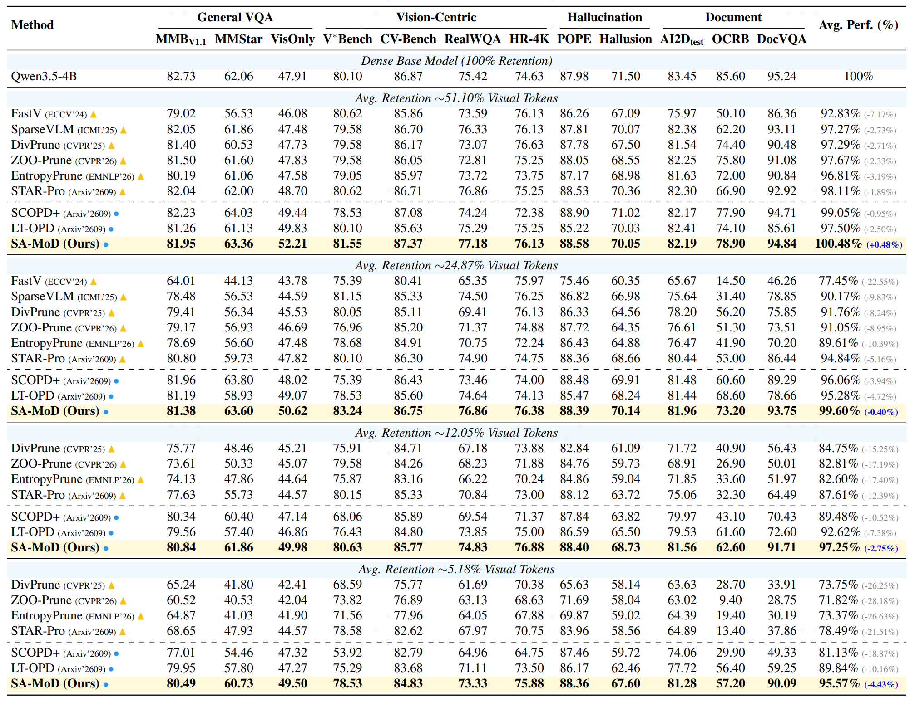

<div align="center">
<h1 align="center">Sparsity-Adaptive Mixture-of-Depth for<br>Efficient Vision-Language Models</h1>
<p align="center">
  Bairui Li<sup>1,2</sup>,
  Xinyu Wei<sup>1,2</sup>,
  Xuyang Liu<sup>1,2</sup>,
  Jinrui Zhang<sup>1,2</sup>,
  Zhiyuan Qi<sup>1</sup>,<br>
  Zeqing Wang<sup>1,2</sup>,
  Wentong Li<sup>1,📧</sup>,
  Lei Zhang<sup>1,2,📧</sup>
</p>
<p align="center">
  <sup>1</sup>The Hong Kong Polytechnic University &nbsp;&nbsp;
  <sup>2</sup>OPPO Research Institute<br>
  <sub><sup>📧</sup>Corresponding authors: <a href="mailto:liwentong95@gmail.com">liwentong95@gmail.com</a>, <a href="mailto:cslzhang@comp.polyu.edu.hk">cslzhang@comp.polyu.edu.hk</a></sub>
</p>
<p align="center">
  <a href="https://arxiv.org/abs/<ARXIV_ID>"></a>&nbsp;
  <a href="https://huggingface.co/datasets/<HF_ORG>/SA-MoD-41K"></a>&nbsp;
  <a href="https://huggingface.co/<HF_ORG>"></a>
</p>
</div>

---

## 📌 Quick Links

[News](#news) · [Highlights](#highlights) · [Pipeline](#pipeline) · [Performance](#performance) · [Code Layout](#code-layout) · [Setup](#setup)

[Pretrained Models](#pretrained-models) · [Datasets](#datasets) · [Training](#training) · [Evaluation](#evaluation) · [Citation](#citation) · [Acknowledgements](#acknowledgements)

If you find SA-MoD useful for your research, a star ⭐ would be greatly appreciated.

## <a id="news"></a>📰 News

- **[2026-XX-XX]** 📦 **Training data released!** [`SA-MoD-41K`](#training-data) (`SA-MoD-Image-25K` and `SA-MoD-Video-16K`) is now available on Hugging Face.
- **[2026-XX-XX]** 🤗 **Checkpoints released!** Pretrained SA-MoD models ([`Qwen3.5-SAMoD-Image-R05`](#sa-mod-released-checkpoints), [`Qwen3.5-SAMoD-Image-R25`](#sa-mod-released-checkpoints), and [`Qwen3.5-SAMoD-Video-R10`](#sa-mod-released-checkpoints)) are now available on Hugging Face.
- **[2026-XX-XX]** 🚀 **Code released!** Training and integrated image/video evaluation pipelines are now public.

## <a id="highlights"></a>✨ Highlights

**Sparsity-Adaptive Mixture-of-Depth (SA-MoD)** is a single-stage post-training framework for efficient long-context visual understanding in vision-language models (VLMs).

- **Sparsity-adaptive Token Routing via Progressive Dense-to-Sparse Transition.** Integrates the **Parameterized Thresholding Mechanism**, **RouterNorm**, and **Density-aware Regularization** to learn content-adaptive, layer-wise visual token routing in a single stage, without fixed budgets, predefined training schedules, and train-inference discrepancies.
- **On-Policy Distillation with Online Hidden-State Alignment (OHiSA).** Adopts On-Policy Distillation as the training objective and aligns teacher and student hidden representations conditioned on the student's sparse trajectory, providing reliable layer-wise supervision.
- **Strong Performance and Efficiency across image and video tasks.** On `Qwen3.5-4B`, SA-MoD retains **99.60% / 95.57%** of dense performance across 12 image benchmarks at **25% / 5%** vision-token retention, and **97.78% / 96.77%** across 5 video benchmarks at **25% / 10%** retention, while delivering up to **3.9×** end-to-end speedup.

<div align="center">
  
</div>

## <a id="pipeline"></a>🧭 Pipeline

<div align="center">
  
</div>

## <a id="performance"></a>📊 Performance

<details open>
<summary>🖼️ Image Benchmark Results</summary>

- Results in Tab. 2 of the main paper

<p align="center">
  
</p>

</details>
<details open>
<summary>🎬 Video Benchmark Results</summary>

- Results in Tab. 4 of the main paper

<p align="center">
  
</p>

</details>

## <a id="code-layout"></a>📁 Code Layout

```text
SA-MoD/
├── VLMEvalKit/                     # Image evaluation suite
├── lmms-eval/                      # Video evaluation suite
├── samod/                          # Training core: SAMoD Qwen3.5, VOPD, OHiSA
└── scripts/
    ├── run_opd_qwen3_5_samod.sh    # On-policy self-distillation training launcher
    ├── merge_checkpoint.sh         # FSDP-to-HF checkpoint merger
    └── eval/
        ├── image_eval/             # VLMEvalKit launcher and benchmark config
        └── video_eval/             # lmms-eval video evaluation launchers
```

## <a id="setup"></a>🛠️ Setup

Use Python 3.12 with a CUDA 13.0 environment. Install PyTorch, dependencies, local packages, and attention kernels:

```bash
pip install torch==2.10.0 torchvision==0.25.0
pip install -e samod
pip install -e lmms-eval --no-deps
pip install -e VLMEvalKit --no-deps
pip install flash-attn==2.8.2 --no-build-isolation
pip install flash-linear-attention==0.4.2 --no-build-isolation
```

## <a id="pretrained-models"></a>📦 Pretrained Models

### Base Model

Download the base `Qwen3.5-4B` checkpoint into `pretrained/Qwen3.5-4B` (used as the initialization and frozen teacher for training, and as the dense baseline for evaluation):

```bash
hf download Qwen/Qwen3.5-4B --local-dir pretrained/Qwen3.5-4B
```

### <a id="sa-mod-released-checkpoints"></a>SA-MoD Released Checkpoints

We release the trained SA-MoD checkpoints on Hugging Face:

| Model | Modality | Target Retention | Hugging Face |
| --- | --- | --- | --- |
| `Qwen3.5-SAMoD-Image-R05` | Image | 5% | [Hugging Face](https://huggingface.co/<HF_ORG>/Qwen3.5-SAMoD-Image-R05) |
| `Qwen3.5-SAMoD-Image-R25` | Image | 25% | [Hugging Face](https://huggingface.co/<HF_ORG>/Qwen3.5-SAMoD-Image-R25) |
| `Qwen3.5-SAMoD-Video-R10` | Video | 10% | [Hugging Face](https://huggingface.co/<HF_ORG>/Qwen3.5-SAMoD-Video-R10) |

You can download any released checkpoint into `pretrained/` or another specified directory for direct evaluation.

## <a id="datasets"></a>🗂️ Datasets

### <a id="training-data"></a>Training Data

We release both the image and video training datasets on Hugging Face:

<table>
  <thead>
    <tr>
      <th>Dataset</th>
      <th>Modality</th>
      <th>Samples</th>
      <th>Subset Path</th>
      <th>Hugging Face</th>
    </tr>
  </thead>
  <tbody>
    <tr>
      <td><code>SA-MoD-Image-25K</code></td>
      <td>Image</td>
      <td>25K</td>
      <td><code>./train_image_25k/</code></td>
      <td rowspan="2"><a href="https://huggingface.co/datasets/<HF_ORG>/SA-MoD-41K">SA-MoD-41K</a></td>
    </tr>
    <tr>
      <td><code>SA-MoD-Video-16K</code></td>
      <td>Video</td>
      <td>16K</td>
      <td><code>./train_video_16k.parquet</code></td>
    </tr>
  </tbody>
</table>

Download the training datasets from Hugging Face:

```bash
hf download --repo-type dataset <HF_ORG>/SA-MoD-41K --local-dir datasets/
```

### Evaluation Data

Image benchmarks are stored in `$LMUData`, and video benchmarks are cached in `$LMMS_EVAL_DATASETS_CACHE`. Both frameworks download missing benchmark files automatically on first run or reuse existing local caches.

## <a id="training"></a>🧪 Training

Launch single-node training on 8 GPUs:

```bash
NNODES=1 NGPU=8 bash scripts/run_opd_qwen3_5_samod.sh
```

Checkpoints, rollout logs, and a snapshot of the launch script and [`samod_cfg.json`](samod/verl/models/qwen3_5_samod/configs/samod_cfg.json) are saved to `workbench/<experiment_name>/<timestamp>/`. When training finishes, the script automatically merges the latest FSDP checkpoint into a Hugging Face checkpoint directory.

### Training Hyperparameters

General training, rollout, and data hyperparameters can be edited directly at the top of [`scripts/run_opd_qwen3_5_samod.sh`](scripts/run_opd_qwen3_5_samod.sh):

| Parameter | Default | Description |
| --- | --- | --- |
| `NNODES` / `NGPU` | `1` / `8` | Number of nodes and GPUs per node, modify as needed |
| `BASE_MODEL_PATH` / `TEACHER_MODEL_PATH` | `pretrained/Qwen3.5-4B` | Student initialization and frozen full-token teacher |
| `TRAIN_BATCH_SIZE` × `ROLLOUT_N` | `32` × `4` | Prompts per step × student rollouts per prompt |
| `LR` / `ROUTER_LR` | `2e-6` / `2e-6` | Learning rates for backbone and per-layer routers |
| `FREEZE_VISION_TOWER` | `false` | Full-parameter training (including vision tower) when `false` |
| `ALPHA` / `JSD Top-K` | `0.5` / `100` | Token-level JSD interpolation coefficient (top-100 logits) |
| `MAX_PROMPT_LENGTH` / `MAX_RESPONSE_LENGTH` | `48896` / `256` | Maximum prompt and generated response lengths |

### SA-MoD Specific Configuration ([`samod_cfg.json`](samod/verl/models/qwen3_5_samod/configs/samod_cfg.json))

Routing, sparsity, and hidden-state alignment settings are defined under `config_overrides` in [`samod/verl/models/qwen3_5_samod/configs/samod_cfg.json`](samod/verl/models/qwen3_5_samod/configs/samod_cfg.json) (each LLM decoder layer uses a zero-initialized `Linear(H → 2)` router producing token scores and a per-image / per-video threshold):

| Key | Default | Description |
| --- | --- | --- |
| `samod_sparsity_target` | `0.05` | Target visual-token retention upper bound (e.g., `0.05`, `0.10`, `0.25`) |
| `samod_margin` | `0.1` | Routing score margin around the learned threshold |
| `samod_weight_norm` | `0.2` | Branch reweighting scale applied to kept visual tokens |
| `samod_dreg_loss_weight` | `0.001` | Weight of Density-aware Regularization toward `samod_sparsity_target` |
| `ohisa_loss_weight` | `1.0` | Weight of Online Hidden-State Alignment (OHiSA) loss |

### Experiment Logging

Logging defaults to console output. To enable SwanLab, export `SWANLAB_API_KEY` and set `TRAINER_LOGGER='["console","swanlab"]'` before launching.

## <a id="evaluation"></a>🔍 Evaluation

Evaluation scripts accept either a merged HF checkpoint or an unmerged FSDP checkpoint (auto-merged via [`scripts/merge_checkpoint.sh`](scripts/merge_checkpoint.sh)). Pass `EVAL_ORIGINAL=1` to evaluate the dense `Qwen3.5-4B` baseline.

### 🖼️ Image Benchmarks Evaluation (VLMEvalKit)

Benchmarks and settings are configured in [`eval_cfg_qwen3_5_integrated.json`](scripts/eval/image_eval/eval_cfg_qwen3_5_integrated.json).

```bash
# SA-MoD checkpoint (results saved to eval_outputs/vlmevalkit/<MODEL_NAME>/)
MODEL_NAME=Qwen3.5-SAMoD-Image-R05 MODEL_PATH=pretrained/Qwen3.5-SAMoD-Image-R05 \
bash scripts/eval/image_eval/qwen3_5.sh

# Dense Qwen3.5-4B baseline
EVAL_ORIGINAL=1 bash scripts/eval/image_eval/qwen3_5.sh
```

### 🎬 Video Benchmarks Evaluation (lmms-eval)

Benchmarks are configured in [`integrated_eval.sh`](scripts/eval/video_eval/integrated_eval.sh). Set `LMMS_LOG_GEN_METRICS=1` to also log average latency, TTFT, and KV-cache usage.

```bash
# Full video suite (results saved to eval_outputs/lmms_eval/<MODEL_NAME>/)
MODEL_NAME=Qwen3.5-SAMoD-Video-R10 MODEL_PATH=pretrained/Qwen3.5-SAMoD-Video-R10 \
bash scripts/eval/video_eval/integrated_eval.sh

# Single benchmark
TASKS=videomme MAX_FRAMES=128 FPS=1 MAX_TOKENS_PER_FRAME=768 MAX_NEW_TOKENS=512 \
MODEL_NAME=Qwen3.5-SAMoD-Video-R10 MODEL_PATH=pretrained/Qwen3.5-SAMoD-Video-R10 \
bash scripts/eval/video_eval/qwen3_5_video.sh

# Dense Qwen3.5-4B baseline
EVAL_ORIGINAL=1 bash scripts/eval/video_eval/integrated_eval.sh
```

## <a id="citation"></a>📖 Citation

If you find SA-MoD helpful in your research, please consider citing our paper:

```bibtex
@article{li2026samod,
  title   = {Sparsity-Adaptive Mixture-of-Depth for Efficient Vision-Language Models},
  author  = {Li, Bairui and Wei, Xinyu and Liu, Xuyang and Zhang, Jinrui and Qi, Zhiyuan and Wang, Zeqing and Li, Wentong and Zhang, Lei},
  journal = {arXiv preprint arXiv:<ARXIV_ID>},
  year    = {2026}
}
```

## <a id="acknowledgements"></a>🙏 Acknowledgements

SA-MoD builds upon [Vision-OPD](https://github.com/VisionOPD/Vision-OPD), [verl](https://github.com/volcengine/verl), [VLMEvalKit](https://github.com/open-compass/VLMEvalKit), and [lmms-eval](https://github.com/EvolvingLMMs-Lab/lmms-eval). We thank the authors and communities behind these open-source projects for their great work.
